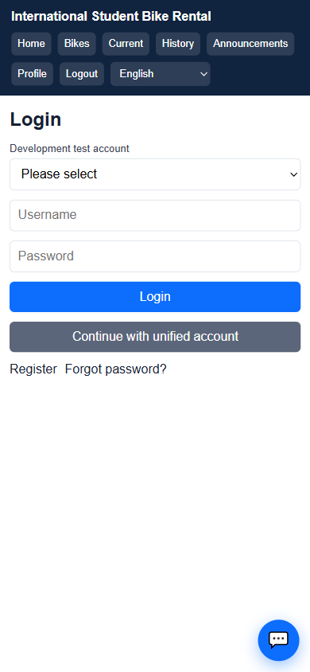
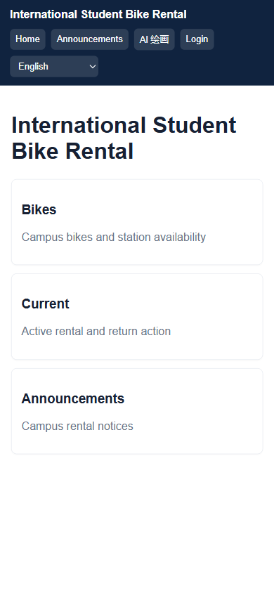
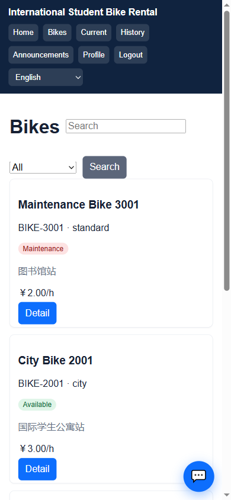
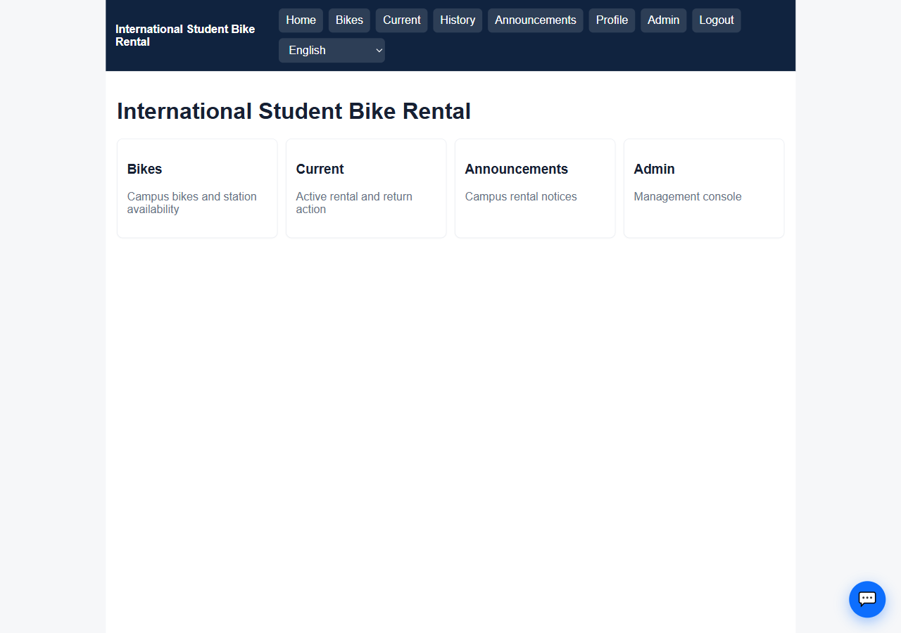
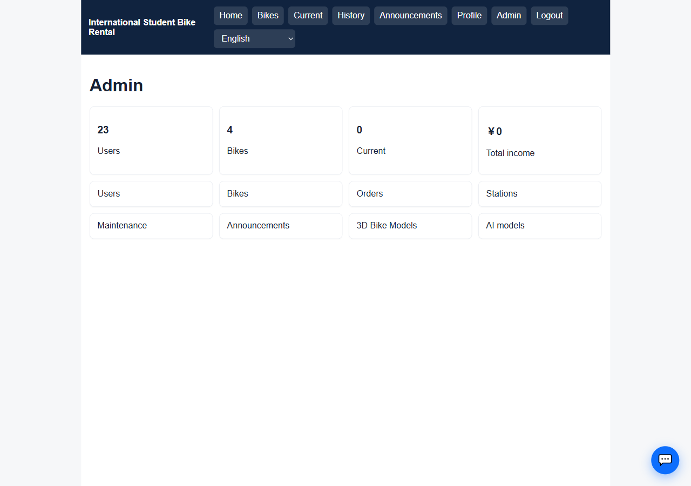
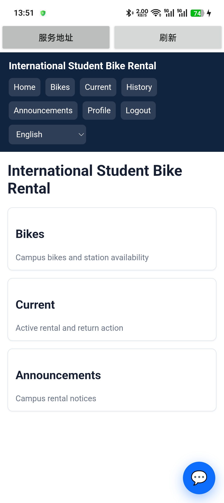

# 国际学生单车租赁系统用户手册

## 目录

1. 引言  
2. 运行环境与访问前提  
3. 用户端操作说明（学生）  
4. 管理端操作说明（管理员）  
5. 智能助手操作说明（共用）  
6. Android 移动端操作说明  
7. 异常与常见问题  
8. 结论

## 引言

本文说明国际学生单车租赁系统 V1.0 的实际使用方式。当前可核验的角色为学生、管理员和维护人员；维护人员入口只开放维护记录菜单，学生和管理员使用门户端，管理员同时使用管理端。

## 运行环境与访问前提

网页端入口为 `http://***:4030`，API 由同源代理提供。Android 客户端在“服务地址”中填写同一网页入口。使用前确认手机与服务端处于同一局域网，页面能打开首页并显示公告。登录后才能访问车辆、订单、个人中心和智能助手；管理员才能进入管理台。

## 用户端操作说明（学生）

### 登录与首页

图 1-1 登录页（Android/移动视口）。入口：`/login`。填写用户名和密码后点击“登录”，成功后进入首页；开发测试环境的账号选择仅在 PC 视口显示，移动端不显示该技术性控件。

图 1-2 首页（PC 移动视口）。入口：`/`。首页提供车辆、当前订单和公告三个高频入口，右下角按钮打开业务助手。

### 查看可租车辆

图 2-1 车辆列表。入口：登录后点击“Bikes”，对应 `/bikes`。页面显示车辆编号、类型、状态、站点和小时价格，可使用关键字与状态筛选；点击“Detail”进入车辆详情。

车辆状态为 Available 时可进入租赁确认页。车辆已租出、维护中或停用时不显示可租操作，接口也会在事务中再次校验状态。

### 租车、当前订单与还车

从车辆详情点击租车，确认起始站点后提交。系统锁定当前用户和车辆，创建 `renting` 订单并将车辆改为 `rented`。进入“Current”查看订单，选择结束站点提交还车；系统计算使用小时数、金额，将订单改为 `completed` 并恢复车辆可租状态。入口分别为 `/rent/:id`、`/orders/current` 和 `/orders/history`。

### 公告与个人中心

点击“Announcements”查看已发布公告及详情；点击“Profile”查看个人资料、修改密码和已绑定的统一登录信息。公告接口只返回公开状态，管理端隐藏公告不会出现在未登录用户列表。

## 管理端操作说明（管理员）

图 3-1 管理员首页。管理员登录后首页增加“Admin”入口，进入 `/admin` 查看用户数、车辆数、当前订单和收入统计。

图 3-2 管理台仪表盘。菜单对应用户、车辆、订单、站点、维护、公告、车型和 AI 模型管理。列表支持分页、关键字和状态筛选，新增和编辑使用表单弹窗。

管理员可以维护车辆状态、站点容量、公告发布状态及维护记录。删除站点时如果存在车辆或历史订单引用，服务端返回冲突错误并保留历史引用。

维护人员只能访问维护菜单，不能进入管理员统计和用户管理页面。路由和后端接口均进行角色校验。

## 智能助手操作说明（共用）

登录后点击右下角“Assistant”打开对话面板。面板可选择已配置模型，输入“现在有哪些站点有车？”等业务问题后发送。助手通过业务工具查询车辆、站点、订单和公告，并按角色限制工具范围；管理员可使用统计工具，学生只能使用个人业务查询。

当前 Linux 测试默认模型为 `qwen3:8b`，已验证能够只返回最终回答。模型冷启动时面板显示等待状态，连接超时会显示可操作的错误提示。公网 HTTP 页面不具备浏览器麦克风安全上下文，语音输入需使用 HTTPS 或 Android 原生能力；本项目当前未形成可核验的语音业务链，因此不在本手册宣称语音功能已交付。

## Android 移动端操作说明

图 5-1 Android WebView 首页。打开客户端后填写服务地址并点击“刷新”。客户端加载同一 H5 页面，首页和业务导航与浏览器一致。移动端导航隐藏开发测试账号选择，保留车辆、订单、公告、个人中心和助手入口，减少页面来回切换。

Android 真机已验证页面刷新、局域网访问和新版导航；本轮未重新构建 APK，使用的是已安装客户端加载最新网页版本。

## 异常与常见问题

1. 页面打不开：检查手机与服务端是否在同一局域网，确认服务地址为 `http://***:4030`，再点击客户端“刷新”。
2. 登录失败：核对账号密码；账号被禁用时联系管理员。
3. 车辆不能租：车辆可能已被其他用户租用、处于维护状态或用户已有活动订单；重新加载车辆列表。
4. 管理菜单返回无权限：确认当前账号是管理员或维护人员，学生账号不能访问管理接口。
5. 助手长时间等待：模型可能正在冷启动或 GPU 资源不足，等待超时后重试；若仍失败，联系系统管理员。
6. 麦克风不可用：浏览器 HTTP 页面不允许麦克风，改用 HTTPS 或按项目实际支持的 Android 能力测试。

## 结论

本手册覆盖已在 PC 浏览器、Linux 服务和 Android WebView 中验证的普通用户、学生、教师租赁、管理员管理、公告和业务助手流程。图片识别和完整语音链路不属于当前版本的已核验范围。
