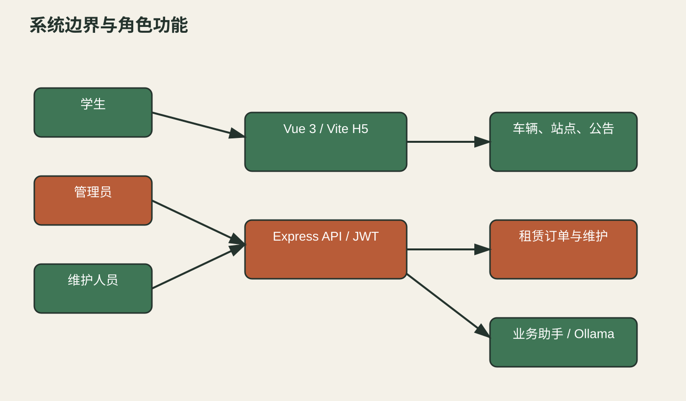
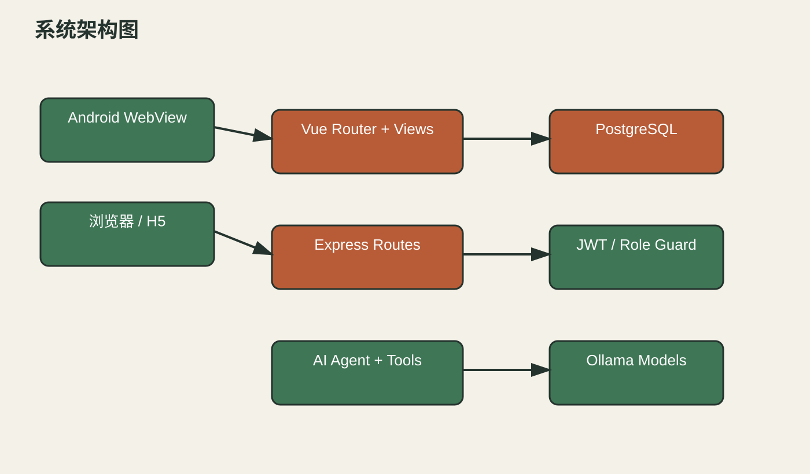
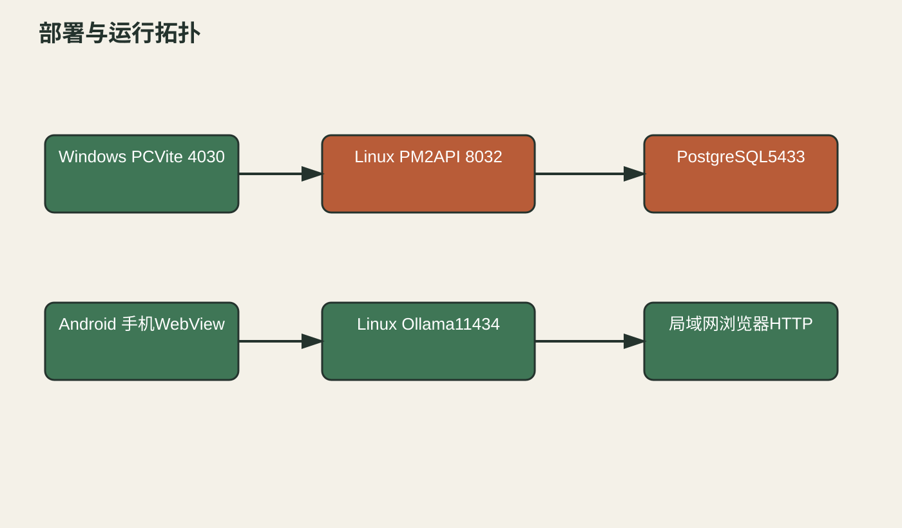
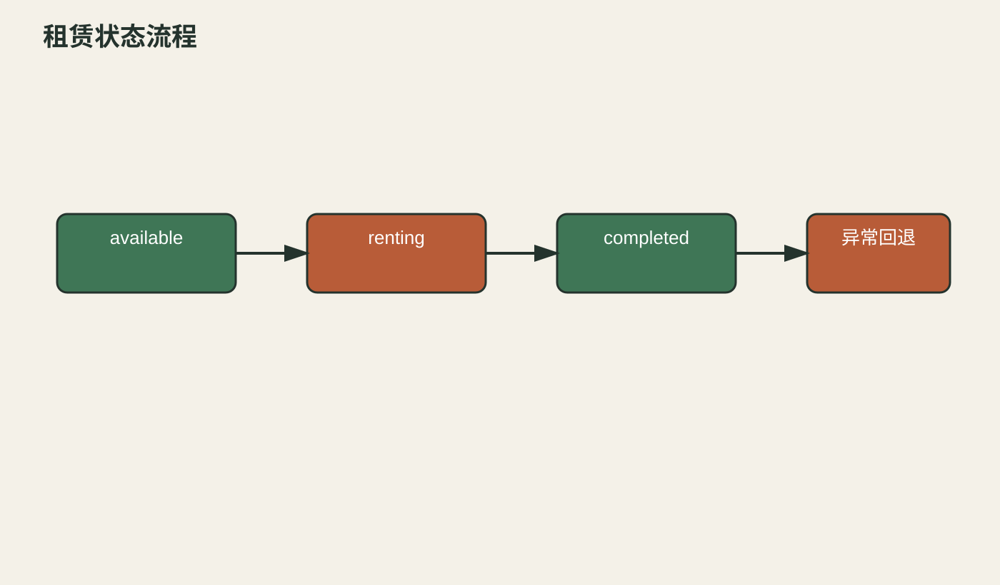

# 国际学生单车租赁系统软件设计说明书

## 目录

1. 引言  
2. 需求概要分析  
3. 系统概述  
4. 总体设计  
5. 详细设计  
6. 数据设计  
7. 接口设计  
8. 运行与部署设计  
9. 安全与权限设计  
10. 测试与验证  
11. 结论

## 1 引言

### 1.1 编写目的

本文依据当前仓库提交 `0d287fe`、运行配置、数据库迁移、真实页面和联调记录，说明国际学生单车租赁系统 V1.0 的结构、数据、接口、部署和已验证行为。文中使用的主机地址统一脱敏为 `***`。

### 1.2 系统范围

系统由 Vue 3/Vite H5、Node.js/Express API、PostgreSQL 数据库、Ollama 业务助手和 Android WebView 客户端组成。业务范围是校园车辆与站点租赁、公告、维护、管理和角色受限的业务问答。教师、普通用户、图像识别和完整语音服务不在当前代码证据范围。

## 2 需求概要分析

### 2.1 需求背景

校园内学生需要查看车辆和站点状态、租车、还车并查询历史；管理人员需要维护用户、车辆、站点、订单、公告和维修记录。系统还提供一个能读取业务数据的助手，减少对管理列表的重复查询。

### 2.2 用户与权限需求

代码定义三类角色：`student`、`admin`、`staff`。学生可查看车辆、公告、个人订单并执行租车和还车；管理员可访问管理台及管理接口；维护人员可访问维护列表和维护操作。系统没有 `teacher` 或 `normal user` 角色，不能据计划文本扩展出不存在的权限。

### 2.3 业务约束

同一用户最多有一笔 `renting` 订单；租车事务先锁用户再锁车辆，数据库部分唯一索引提供并发兜底。车辆只有 `available` 状态才能租用，还车后订单为 `completed`，车辆恢复为 `available`。被车辆或历史订单引用的站点不能直接删除。

## 3 系统概述

### 3.1 系统边界

系统边界图根据路由、角色中间件和运行截图确认了三类实际角色及主要功能入口。

图 3-1 系统边界与角色功能图。学生通过 H5 使用车辆、订单和公告，管理员通过管理台维护业务数据，维护人员只进入维护菜单；API 通过 PostgreSQL 读写业务数据，并连接 Ollama 提供助手回答。

### 3.2 功能组成

前端路由包括登录、注册、密码找回、车辆、订单、公告、个人中心和管理台。后端路由包括认证、用户、车辆、站点、订单、维护、公告、仪表盘、车型、支付和 AI。Android 客户端不复制业务逻辑，只加载局域网 H5 页面。

## 4 总体设计

### 4.1 分层架构

系统采用表现层、API 业务层、数据层和 AI 支撑层。前端只通过相对 `/api` 路径请求后端，Vite 开发/预览代理到 8032，避免 Android WebView 将 `localhost` 误指向手机自身。

图 4-1 系统架构图。Vue Router 和页面组件组成表现层；Express 路由、JWT 中间件、角色中间件和事务服务组成业务层；PostgreSQL 保存用户、站点、车辆、订单、公告和维护记录；AI Agent 对接 Ollama 模型并通过工具读取业务数据。

### 4.2 技术选型与分层映射

| 层次 | 技术与模块 | 依据 |
|---|---|---|
| 表现层 | Vue 3、Vite、Vue Router、CSS | `frontend/package.json`、`frontend/src` |
| 业务层 | Node.js、Express、JWT、bcryptjs | `backend/package.json`、`backend/src` |
| 数据层 | PostgreSQL、迁移、事务、约束 | `backend/postgres`、`backend/src/config/db.js` |
| AI 层 | Ollama 原生流、OpenAI 兼容适配器、AI 工具 | `backend/src/ai` |
| 移动端 | Android Java WebView | `android/app/src/main` |

### 4.3 部署拓扑

Windows PC 用于浏览器测试，Linux GPU 服务器运行 API、前端预览、Ollama 和 PostgreSQL 容器，Android 通过局域网加载网页服务。

图 4-2 部署与运行拓扑图。网页端口为 4030，API 端口为 8032，Ollama 默认使用 11434，Linux 项目通过 PM2 管理 `bike-backend` 和 `school-bike-rental-web`。

## 5 详细设计

### 5.1 认证模块

登录接口接收用户名和密码，使用 bcryptjs 比对密码，成功后签发包含用户 ID、用户名和角色的 JWT。前端将 token 放在同源请求的 Authorization 头中；路由守卫负责阻止未登录用户进入受保护页面，后端中间件再次校验 token，避免只依赖前端控制。

认证失败返回统一错误结构，页面在登录表单下方显示错误；会话失效时前端清理本地认证状态并回到登录页。统一登录 OIDC 流程只在配置了 issuer 和客户端后可用，不能把开发测试账号当成生产认证。

### 5.2 车辆与站点模块

车辆列表支持关键字、状态和分页。车辆记录包含业务编号、名称、类型、状态、站点、小时价格、图片地址和描述。站点记录包含中英文名称、地址、经纬度和容量。列表接口使用白名单排序和边界化分页，避免任意列名和超大 offset。

### 5.3 租车流程

图 5-1 租赁状态流程。车辆从 `available` 进入 `renting` 的触发条件是用户无活动订单且车辆仍可用；还车触发 `renting` 到 `completed`，同时恢复车辆状态。冲突、无车和重复租赁均在事务中返回错误，不修改半成数据。

租车处理步骤：接收车辆和起始站点；锁定用户；查询活动订单；锁定车辆；校验车辆状态；写入订单；更新车辆状态；提交事务。还车处理步骤：锁定订单；校验订单属于当前用户或当前用户是管理员；计算小时数和金额；更新订单；恢复车辆站点和状态。

### 5.4 管理台模块

管理台使用 `adminSchemas.js` 声明列表列、筛选字段和表单字段，由 `AdminList`、`AdminTable` 和 `AdminFormDialog` 统一渲染。这样用户、车辆、订单、站点、维护、公告和车型的分页、编辑、删除行为保持一致，但每种实体仍由后端独立校验。

### 5.5 AI 业务助手

AI 路由先校验登录身份，再按角色生成工具定义。学生工具只包含个人租赁和公开业务查询；维护人员可读维护相关数据；管理员可以读取管理统计。执行工具前再次检查 `roles`，即使模型生成越权工具名也会被拒绝。

助手使用 NDJSON 流而不是 SSE，因为请求需要携带 Authorization。Ollama 适配器处理模型流、工具调用和超时，AI Agent 负责多轮工具调用、结果回灌和重复调用去重。Linux 测试默认 `qwen3:8b`，实测回答只展示最终业务答案；`qwen3:4b` 的思考内容不适合作为默认模型。

### 5.6 Android WebView 模块

Android 客户端提供服务地址输入、刷新和同源页面容器。它不注入 JavaScript bridge，也不复制前端业务逻辑。当前安装版本加载网页刷新后已能看到移除 AI 绘画入口后的页面；本轮尚未重新构建 APK，因此安装包版本仍需另行登记。

## 6 数据设计

### 6.1 核心实体

核心表为 `users`、`stations`、`bikes`、`rental_orders`、`maintenance_records`、`announcements`。用户与订单是一对多；车辆与订单是一对多历史关系；站点与车辆是一对多；维护记录关联车辆和维护人员；公告可关联创建者。

### 6.2 字段和约束

用户角色限制为 `student/admin/staff`，状态限制为 `active/disabled`；车辆状态限制为 `available/rented/maintenance/disabled`；订单状态限制为 `renting/completed/cancelled`。迁移 003 为订单起止站点增加 `ON DELETE RESTRICT`，保护历史记录。迁移 005 增加车型、支付和国际化字段，应用迁移记录 checksum，避免已应用版本被静默修改。

### 6.3 事务与并发

租车事务以用户行锁为第一锁，再锁车辆行，保持所有租赁路径的锁顺序一致。数据库部分唯一索引保证一个用户最多一条活动订单；服务层捕获唯一约束冲突并转换成可读错误。

## 7 接口设计

本文档中只列出关键业务接口。

| 接口 | 方法 | 鉴权 | 用途 |
|---|---|---|---|
| `/api/health` | GET | 无 | 服务健康检查 |
| `/api/auth/login` | POST | 无 | 用户登录并签发 JWT |
| `/api/bikes` | GET | 可选 | 查询车辆分页列表 |
| `/api/orders/rent` | POST | student/admin | 创建租赁订单 |
| `/api/orders/:id/return` | PUT | student/admin | 归还车辆并结算 |
| `/api/orders/current` | GET | 登录 | 查询当前用户活动订单 |
| `/api/admin` 路由集合 | GET/POST/PUT/DELETE | admin | 管理业务数据 |
| `/api/ai/models` | GET | 可选 | 查询模型目录 |
| `/api/ai/chat` | POST | 登录 | NDJSON 业务对话 |

接口统一返回 `code`、`message`、`data`；分页接口的 `data` 包含 `list`、`total`、`page` 和 `pageSize`。错误状态至少包括 400 参数/业务校验、401 未登录、403 角色不足、404 资源不存在和 409 历史引用冲突。

## 8 运行与部署设计

### 8.1 Windows

后端在 `backend` 运行 `npm run dev`，前端在 `frontend` 运行 `npm run dev`。前端监听 4030，代理 `/api` 到 8032。只在本地测试配置中启用开发账号下拉，移动端通过 CSS 隐藏该技术性控件。

### 8.2 Linux

Linux 项目路径为 `/ds1/workspace/front/school-bike-rent-international`。PM2 进程为 `bike-backend` 和 `school-bike-rental-web`；数据库为 PostgreSQL18 容器映射的 5433，Ollama 监听 11434。部署步骤为同步代码、安装依赖、执行 `npm run db:init`、构建前端、重启 PM2 并调用 `/api/health`。

### 8.3 Android

Android 客户端填写服务端网页地址后刷新，页面通过同源代理访问 API。若网络切换或页面缓存旧版本，应点击刷新；本轮刷新后确认 AI 绘画入口已移除。

## 9 安全与权限设计

密码使用 bcryptjs 哈希保存，JWT 使用独立密钥签名；真实密码、API Key 和数据库连接信息仅保存在被忽略的 `.env`。用户列表、管理写操作、维护菜单和 AI 管理接口都由服务端角色中间件保护。AI 工具执行层再次校验角色，提示词不会替代后端授权。

生产部署需要 HTTPS，尤其是浏览器麦克风能力；公网明文 HTTP 不应被用于真实密码或生产业务。备份工具要求独立的加密密钥和隔离测试库，不能将业务库直接用于演示数据播种。

## 10 测试与验证

### 10.1 自动化验证

后端 `npm test` 共 25 项通过，覆盖数据库标识符、迁移 checksum、OIDC token、分页、排序白名单、备份恢复、限流客户端识别和站点历史外键。前端 `npm run build` 通过，只有 Three.js chunk 大于 500 kB 的构建提示。

### 10.2 联调验证

Windows 到 Linux API 的 `/api/health` 返回 200；公告查询返回 200；学生车辆和当前订单返回 200，学生访问用户管理返回 403；管理员访问用户、仪表盘和维护返回 200；学生完成一次租车和还车，订单状态为 `completed`。Playwright 验证了登录、学生车辆、管理员首页和助手回答；ADB 真机验证了 Android WebView 刷新后的首页。

### 10.3 未完成验证

教师和普通用户角色不在代码中；图片上传识别、语音识别、语音合成及完整离线/弱网证据未形成可核验链路；APK 尚未按最新源码重新构建安装；手册没有覆盖所有弹窗和异常页面。这些项目在内部索引中保持为缺口，当前文档应视为草稿/需人工确认。

## 11 结论

本设计说明书反映当前可运行的学生单车租赁系统，不把计划中的其他教学或多模态能力扩写为既成事实。正式提交前应补齐角色范围、APK 版本、完整页面截图和 PDF 终检记录。
